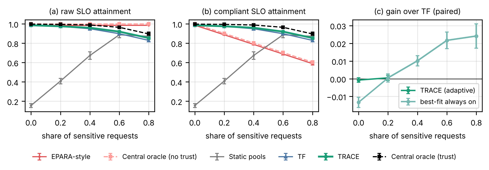
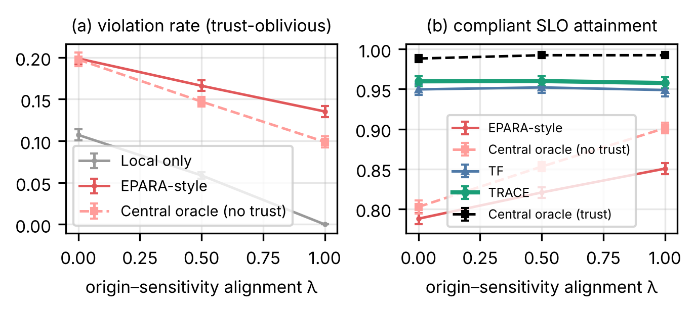
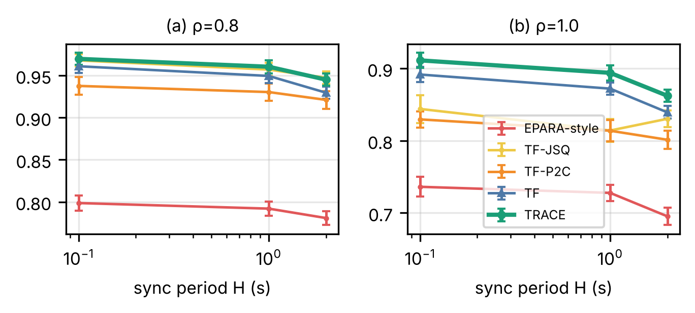
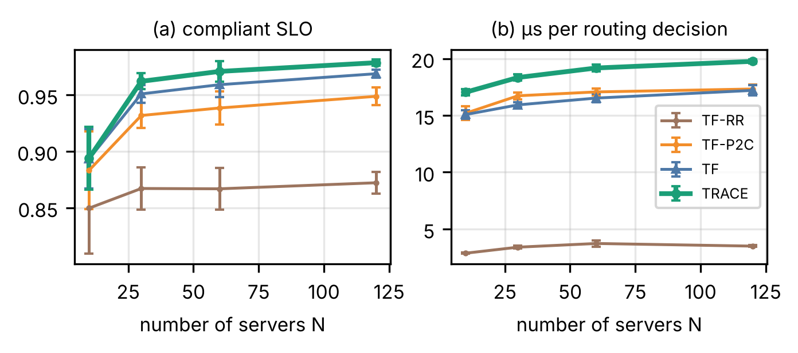

# VI. Results: Trust-Constrained Routing

Unless stated otherwise, results are for $N=30$ servers, offered load $\rho=0.8$, 40% sensitive traffic and unconstrained energy; $\Delta$ denotes a paired difference in compliant SLO attainment (C-SLO) over seeds, with its 95% confidence interval and Holm-adjusted $p$-value $p_H$.

## A. Compliant routers and the cost of compliance

Fig. 2 and Table III summarize the load sweep. Among the decentralized routers that never violate the constraint, TRACE attains the highest C-SLO at every load from 0.5 to 1.2 (tied with TF-JSQ at 0.5 and 0.8); only the centralized oracle with trust, which has perfect information, does better below saturation. At $\rho=0.8$ it reaches 0.960 ± 0.006. The trust filter alone (TF) reaches 0.950, so best-fit clearance adds 1.0 point ($\Delta=+0.010\pm0.003$, $p_H=10^{-6}$); this is a small but consistent gain. Among the decentralized baselines, TF-JSQ comes closest (0.956) and is statistically indistinguishable from TRACE at this load ($\Delta=+0.004\pm0.003$, $p_H=0.08$), followed by TF-P2C (0.929) and TF-RR (0.870). The difference between the three decentralized alternatives lies in how much they forward and shed: round-robin ignores capacity and sheds 13% of requests, P2C compares only two random peers, and the synchronized backlog that JSQ minimizes is a good signal below saturation. Static pools, the partitioning a practitioner might deploy by default, attain only 0.673: non-sensitive requests, which are 60% of the traffic, are confined to the 30% of servers with clearance 0, and those servers are overloaded while the rest of the fleet has spare capacity.

The cost of compliance is small when the router is good. A centralized oracle with perfect, fresh information attains a raw SLO of 1.000 without the constraint and 0.988 with it, so complying costs 1.2 points ($\Delta=0.012\pm0.004$). The equivalent comparison for decentralized routing, the EPARA-style router's raw SLO (0.986) against TRACE, gives 2.7 points ($\Delta=0.027\pm0.006$). TRACE is 2.9 points below the compliant oracle ($\Delta=0.029\pm0.005$). The EPARA-style router processes 19.9% of its requests at ineligible servers, within the range that Eq. (4) and the random-destination bound predict (18.4% to 21.6%), so only 0.788 of its requests are both timely and lawful. Local-only service sheds 43% of requests at this load; among the requests it does process, 18.7% are violations, matching Eq. (4). Measured as compliant goodput, TRACE delivers 1868 requests/s against 1533 for the EPARA-style router, but we stress that this comparison mixes a feasible and an infeasible solution of (3); the informative numbers are the comparisons among compliant routers and the cost of compliance.

The category-balanced metric (Fig. 2b) gives the same ordering, with one exception: TF-JSQ is 1.0 point ahead of TRACE at $\rho=0.8$ ($p_H=0.002$), and the two are tied at $\rho=1.0$ and 1.2.

At and beyond saturation the ranking separates. At $\rho=1.0$, TRACE (0.895) leads TF (0.875), TF-JSQ and TF-P2C (both 0.814) and TF-RR (0.752), all with $p_H<10^{-5}$. At $\rho=1.2$, TRACE (0.733) leads TF-P2C (0.651), TF-RR (0.633) and TF-JSQ (0.590) ($p_H<10^{-7}$), while its lead over TF (0.719) is no longer significant ($p_H=0.08$). JSQ degrades most, consistent with the herding that deterministic choices on shared, stale information cause and that sampling avoids [@mitzenmacher2000old]. In overload, TRACE also exceeds the compliant oracle (0.859 at $\rho=1.0$, 0.503 at $\rho=1.2$). The oracle accepts every request that it can still serve in time, including eight-slot jobs that crowd out many short ones; its greedy dispatch has no admission policy, so it is a strong reference below saturation but not an upper bound above it.

{width=6.5in}

TABLE_MAIN_PLACEHOLDER

## B. Share of sensitive traffic and adaptive best-fit clearance

Fig. 3 varies the share of sensitive requests from 0 to 80%. The cost of compliance grows with the sensitive share because the set of eligible servers shrinks: the compliant oracle falls from 0.998 to 0.896, and the gap to the unconstrained oracle grows from 0.2 to 10.4 points. TRACE follows the same trend from 0.986 to 0.854 and stays 1.2 to 4.5 points below the compliant oracle.

Best-fit clearance helps exactly where the analysis of Section IV-B predicts. Its gain over TF is zero at 0% and 20% sensitive traffic and grows to +1.0, +2.2 and +2.4 points at 40%, 60% and 80% (all $p_H<2\times10^{-6}$), and the category-balanced gains are similar (+0.9 to +1.9 points). When best-fit is always on, it costs 1.3 points with no sensitive traffic ($p_H=2\times10^{-8}$). The adaptive rule removes this cost: TRACE is indistinguishable from TF at 0% and 20% ($p_H=1$) and identical to always-on best-fit from 40% upward. The parameters of the rule were fixed beforehand on separate tuning seeds (Table IV): $\gamma=0.3$ had the largest mean gain across sensitive shares, and the gain changed sign between 20% and 40%, which gave the threshold $q^\ast=30\%$. These evaluation results, on different seeds, confirm the choice.

Static pools behave in the opposite way. With little sensitive traffic, most requests compete for the few clearance-0 servers, and static pools collapse (0.156 at 0%, 0.409 at 20%). When most traffic is sensitive, the pools match the traffic and static partitioning becomes competitive: at 60% and 80% sensitive traffic it is statistically tied with TRACE ($\Delta=+0.032$, $p_H=1$, and $\Delta=-0.017$, $p_H=0.19$). Adaptive routing is therefore most valuable when the sensitive share is unknown or changes over time.

{width=6.5in}

TABLE_TUNE_PLACEHOLDER

## C. When sensitive data originates at high-clearance sites

The violation rate of a trust-oblivious router is set by the label distributions (Section III-E). Fig. 4 tests how much of it remains when sensitive data originates where it may be processed. With full alignment ($\lambda=1$), local-only service causes no violations, as Eq. (4) predicts, but offloading still does: the EPARA-style router violates for 13.5% of requests and the unconstrained oracle for 9.9%, because a sensitive request that cannot be served at its ingress server is offloaded to whichever peer has capacity, eligible or not. The violation rate therefore falls only from 19.9% to 13.5% for the EPARA-style router. Alignment barely changes the compliant routers (TRACE 0.960, 0.960 and 0.958 at $\lambda=0$, 0.5 and 1), nor the cost of compliance under perfect information (1.2, 0.8 and 0.8 points). In short, aligning data with clearance makes violations rarer but does not remove the need for a trust filter in the router.

{width=4.6in}

## D. Overload and SLO-aware admission

Table V isolates the admission rule. When every router processes requests that can no longer meet their SLO ("serve late"), all of them collapse at saturation: C-SLO at $\rho=1.0$ is between 0.07 and 0.25 and the compliant oracle reaches only 0.20. Late work occupies slots without contributing goodput and delays everything queued behind it, so the backlog grows without bound. Shedding requests that can no longer meet their SLO lifts every router, by 51 to 76 points at $\rho=1.0$ and by 50 to 70 points at $\rho=1.2$ (all $p_H<4\times10^{-8}$). The admission rule, not the choice of peer, is the decisive design element in overload, and it is simple to add to any of the routers.

We also tested two fallbacks for the moment when the local view shows no eligible peer with spare capacity. Probing an eligible peer uniformly at random is neutral (within ±1.1 points of TF with either admission rule, $p_H\ge0.25$). A power-of-two-choices probe on synchronized backlog is harmful, by 1.1 to 5.9 points ($p_H\le5\times10^{-4}$), because it adds forwards toward peers that are themselves saturated. With shedding in place, no fallback is needed.

TABLE_OVER_PLACEHOLDER

## E. State staleness

Fig. 5 varies the synchronization period $H$. With SLO-aware admission, fresher state helps the capacity-proportional routers at both loads: TRACE gains 2.5 points at $\rho=0.8$ and 5.0 points at $\rho=1.0$ when $H$ falls from 2 s to 0.1 s ($p_H<10^{-4}$), and TF behaves alike. TF-JSQ, which acts deterministically on the synchronized backlog, benefits least from fresh state at $\rho=1.0$ (+1.4 points, $p_H=0.15$), and it is 3.3 to 8.1 points behind TRACE at that load for every $H$ tested. At $\rho=0.8$, TRACE and TF-JSQ are tied for both short and long sync periods.

{width=4.6in}

## F. Partial placement and a cloud fallback

Table VI relaxes two simplifications. When each service is hosted on only half of the servers (at least one per domain), all routers lose: TRACE falls from 0.961 to 0.906, because fewer eligible servers host each service. A cloud tier with 96 slots, 40 ms one-way latency and clearance 1 recovers part of this loss (TRACE 0.932 with partial placement and 0.970 with full placement), while serving only 0.9% to 2.7% of the requests. The cloud cannot help sensitivity-2 requests, which must stay in their domain. TRACE's advantage over the EPARA-style router is stable across all four settings (+14.1 to +16.9 points, $p_H<10^{-5}$).

TABLE_CLOUD_PLACEHOLDER

## G. Robustness to parameters and topology

Appendix Table IX varies one parameter at a time (10 seeds). TRACE stays within 0.919 and 0.981 C-SLO in every setting and is ahead of TF in every one. The largest effects are structural: allowing only one forward ($K_{\max}=1$) costs 4.3 points, and more trust domains cost capacity for sensitivity-2 requests (0.981 with one domain, 0.942 with five). A short capacity horizon ($\Delta=0.1$ s) costs 1.9 points; the proximity scale $\ell_0$ has no measurable effect, and removing the fit preference (factor 0) slightly helps. With fewer high-clearance servers (clearance mix 0.5/0.3/0.2), TRACE falls to 0.933, and with more (0.2/0.4/0.4) it rises to 0.972.

Confidence intervals across seeds are dominated by topology. Running five arrival sequences on each of ten topologies, the topology accounts for 88% of the variance of the EPARA-style router's C-SLO and 58% of TRACE's (intraclass correlation). TRACE's gain over the EPARA-style router, however, is positive on every topology (+12.6 to +18.5 points), and it is not correlated with the share of capacity eligible for sensitivity-2 requests (Spearman $-0.04$, $p=0.91$). Paired comparisons over seeds, which cancel the topology effect, are therefore the appropriate test, and they are what we report.

## H. Scale and decision overhead

Fig. 6 varies the number of servers from 10 to 120 (10 seeds). TRACE's C-SLO rises with scale (0.894 at $N=10$, 0.979 at $N=120$), because larger systems contain more eligible peers at every sensitivity level, and it is at or above TF, TF-P2C and TF-RR at every size. A routing decision takes 17 to 20 µs in our Python prototype (measured while two simulations shared two CPU cores), almost independent of $N$ because the per-peer arithmetic is vectorized; TF-RR is cheaper (3 µs) but routes worse. This is nearly four orders of magnitude below the tightest SLO of 150 ms, and the decision needs no communication. The cost that does grow with $N$ is the age of the synchronized view (Section IV-C), which our simulator does not model and which we leave to future work.

{width=4.6in}
